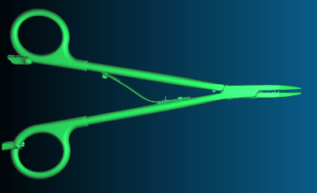
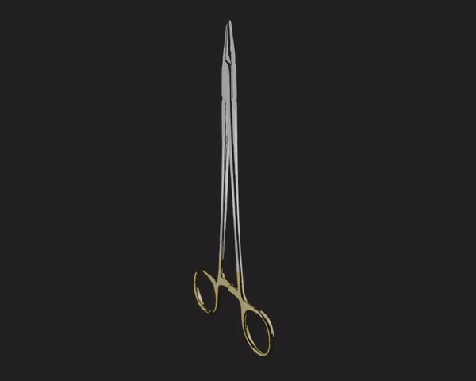
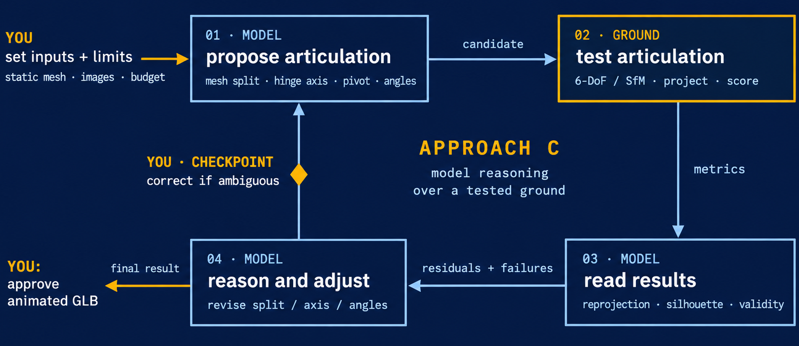

Degree level: PhD

# Project proposal

**Project title: Agentic Articulation Recovery from 3D Scans**

## 1. The problem and goal

**The problem and goal in my project:**

A 3D scanner can capture the shape of a surgical tool in high detail, but its output is a **static mesh**. It does not tell a 3D application which surfaces belong to each moving arm, where the hinge is, or how the tool opens and closes. Turning the scan into an articulated model therefore requires someone to cut and clean the mesh, locate a pivot and rotation axis, and rig the parts. In [Spektor et al., *Monocular pose estimation of articulated open surgery tools — in the wild*](https://arxiv.org/pdf/2407.12138), this part of the workflow was performed manually: the needle-holder mesh was separated into two rigid pieces before different opening states were generated.

*Figure 1. One of my existing 3D-scanned needle holders. The geometry is available, but the split between moving parts and the hinge's position and direction are not encoded in the mesh. Image: my scan.*

I have several static scans of surgical instruments and photographs showing the instruments in different opening and closing states. I will organize the photographs using a **JSON scene manifest**: each scene contains multiple viewpoints of the instrument held at one fixed opening state, and different scenes represent different opening states. **My goal is an AI agent that uses this visual evidence to turn a needle-holder scan into a functional articulated GLB model**, automatically proposing the two rigid parts, the pivot, and the axis of rotation. It should allow optional human corrections when a case is ambiguous, but should not require a manually specified hinge. The GLB will contain transformable rigid parts under a pivot hierarchy and support continuous opening and closing.

**Initial milestone and scope:** I will start with **one scanned needle holder**, modeled as **two rigid arms connected by one revolute hinge**, and a small number of scenes, each photographed from multiple viewpoints at a fixed opening state. Camera information will come from the existing pose-estimation pipeline. Multiple hinges, generalization to other instrument types, and deformable tools such as tweezers are outside the initial scope.

*Figure 2. Reference CAD rendering of a surgical needle holder, illustrating the type of model I want to make articulated and movable.*

**How I will measure success:** I will compare the rendered articulation with photographs at different opening states using **2D reprojection error (pixels)** for available correspondences and **silhouette intersection-over-union (IoU)**, including held-out images when the available views permit. I will also verify that the exported GLB preserves the scanned geometry, contains a valid two-part pivot hierarchy, and supports plausible continuous opening and closing. To measure the value of agentic reasoning, I will compare final fit and improvement across iterations with a **non-agentic search baseline under the same evaluation-call budget**. Numerical acceptance thresholds will be set after initial feasibility tests.

## 2. The simulator

**The simulator in my project:**

My **deterministic ground** will combine our team's in-house **model-free and model-based 6-DoF pose-estimation pipeline**, which includes incremental structure-from-motion (SfM), with a new geometry and articulation evaluator.

**Scene organization and existing pipeline:** The input will include a JSON manifest that groups photographs by scene. **Within each scene, the instrument is held at one fixed articulation state and photographed from several viewpoints.** This makes it possible to run our existing incremental SfM and 6-DoF pose-estimation pipeline separately for each scene under a rigid-object assumption. The **model-based estimator uses a rigid reference mesh**. It provides per-image global object poses and geometric observations, including point clouds and 2D-to-3D correspondences. It is Python-callable without a GUI and runs repeatedly in seconds. The pipeline does not identify the mesh split or joint parameters, I will test whether pose estimates remain sufficiently robust when the opening state differs from the rigid reference mesh.

**What the evaluator will test:** Each trial will take the static mesh, a proposed two-part mesh split, shared hinge pivot and rotation axis, and one opening angle per scene, together with the photographs, camera information, correspondences, and any required scene-to-scan registrations. Deterministic tools will transform and project the proposed parts and return reprojection error, silhouette IoU, joint/geometry validity checks, scene-registration residuals, and per-view failure diagnostics. The inputs and results will be JSON-compatible and callable through Python tools exposed to the agent.  Registration and geometric scoring will be performed by the ground, not the LLM.

**First feasibility check:** For one needle holder, I will verify that SfM is consistent within each fixed-articulation scene, that independent scene reconstructions can be reliably aligned to the scan. I will then compare plausible and deliberately incorrect splits, pivots, and axes to test whether the evaluator distinguishes good from bad articulation hypotheses.

## 3. The agent's role

**The agent in my project:**

The LLM-based agent will run the course's **Approach C: propose → run → read → adjust** loop. Its job is to choose and revise *articulation hypotheses*.

*Figure 3. Adapted Approach C loop for my project.*

1. **Set the task.** Receive a static mesh, a JSON manifest of multi-view scenes (one fixed articulation state per scene), pipeline outputs, and a maximum iteration budget. Ask the user for a rough hint only if necessary.
2. **Propose.** Inspect the instrument shape and available geometric evidence, choose an initial split into two rigid arms, and propose a shared pivot and axis plus **one opening angle per scene**.
3. **Run the ground.** Use deterministic tools to register the independent scene reconstructions to the scan as needed, transform and project the candidate parts, assess correspondences and silhouettes, and check joint and geometry validity.
4. **Reason and adjust.** Read the ground's diagnostics, distinguish poor scene alignment from an incorrect mesh split or hinge, and revise the articulation hypothesis before testing again.
5. **Stop and verify.** Stop when fit improvement becomes small or the experiment budget is exhausted. Export an articulated **GLB** and ask for human approval.

The agent can adjust the mesh segmentation, hinge axis, pivot, and opening angles. It should add value by reasoning about geometric errors, identifying their likely causes, and deciding what to try next, rather than relying on a fixed optimization strategy. I will compare its performance with a non-agentic baseline.

**One question I still need to answer:** Can the agent reason about why an articulation hypothesis fails and use that feedback to improve its next attempt, rather than relying on trial and error?

## Explain your project to someone outside your field

**My project in simple words:**

Imagine making a detailed 3D scan of a surgical needle holder. The scan looks like the real instrument, but it is static: its handles cannot move. To make it animated, someone must decide which pieces move together and where to place the axis that lets them rotate. Doing that by hand takes time and experience.

I want to build an AI agent that learns these missing mechanical clues from groups of photographs: in each group, the tool stays at one opening angle while the camera views it from different directions. A geometry program will first relate these separate groups to the original scan, then test the agent's guess about how to divide the scan and where the hinge belongs. The agent will improve its guess using those measurements and, after a final human check, produce a 3D file that can open and close smoothly.
